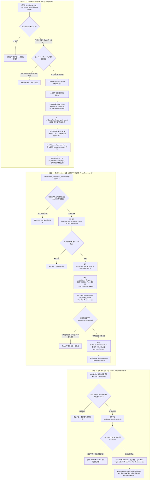
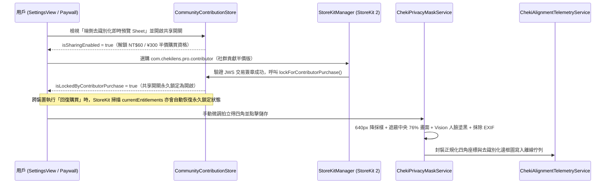

# ChekiLens 社群模型優化：端側去識別化上傳、全自動訓練與 OTA 熱更新架構藍圖 (Phase 8)

> **設計目標**：在不收集任何個人肖像、手寫簽名或 EXIF 定位隱私的前提下，透過用戶手動微調四角座標回饋，全自動完成模型增量訓練、黃金測試集防退步檢驗與 iOS 端免審核 OTA 熱更新。
> **商業與授權策略**：開啟共享可享半價買斷 `com.chekilens.pro.contributor`（`NT$60 / ¥300`）；一旦以半價方案完成購買，系統將永久鎖定共享開關為開啟狀態（支援跨裝置「回復購買」自動同步鎖定）。

---

## 🏗️ 端到端完整流程圖 (End-to-End Architecture Flowchart)

---

## 🔐 購買半價 Pro 與共享開關鎖定狀態機 (Contribution & Paywall Sequence)

---

## 🗂️ 對應程式碼與腳本索引 (Codebase Mapping)

| 階段 | 模組職責 | 檔案路徑 |
| :--- | :--- | :--- |
| **階段 1：端側隱私與佇列** | 四角凸包幾何檢驗、640px 降採樣、中央 76% 遮蔽、Vision 人臉遮罩、EXIF 抹除 | [`ChekiPrivacyMaskService.swift`](file:///Users/tcwang/Documents/ChekiLens/ChekiLens/Sources/Services/ChekiPrivacyMaskService.swift) |
| **階段 1：端側隱私與佇列** | 離線持久化上傳佇列、Manifest SHA256 驗證與 OTA `.mlmodelc` 儲存管理 | [`ChekiAlignmentTelemetryService.swift`](file:///Users/tcwang/Documents/ChekiLens/ChekiLens/Sources/Services/ChekiAlignmentTelemetryService.swift) |
| **階段 1：半價 Pro 鎖定** | 共享開關狀態機、半價 Pro 購買資格檢查與永久鎖定規則 | [`CommunityContributionPolicy.swift`](file:///Users/tcwang/Documents/ChekiLens/ChekiLens/Sources/Services/CommunityContributionPolicy.swift) |
| **階段 1：StoreKit 2** | 標準價 (`com.chekilens.pro.lifetime`) 與半價貢獻版 (`com.chekilens.pro.contributor`) 雙 SKU 管理 | [`StoreKitManager.swift`](file:///Users/tcwang/Documents/ChekiLens/ChekiLens/Sources/Services/StoreKitManager.swift) |
| **階段 1：UI 整合** | 設定頁開關、去識別化即時預覽 Sheet、單張與批次裁切儲存掛載 | [`SettingsView.swift`](file:///Users/tcwang/Documents/ChekiLens/ChekiLens/Sources/Views/Settings/SettingsView.swift)、[`ChekiDetailView.swift`](file:///Users/tcwang/Documents/ChekiLens/ChekiLens/Sources/Views/Detail/ChekiDetailView.swift)、[`BatchPairingView.swift`](file:///Users/tcwang/Documents/ChekiLens/ChekiLens/Sources/Views/Pairing/BatchPairingView.swift) |
| **階段 2：自動化訓練管線** | 後端樣本清洗、冪等合併、訓練觸發、黃金測試集守門與 OTA 清單打包 | [`ingest_community_annotations.py`](file:///Users/tcwang/Documents/ChekiLens/scripts/ingest_community_annotations.py) |
| **階段 2：CI/CD 排程** | 每週於 `macos-14` 自動重訓、編譯 `.mlmodelc` 並發布至 GitHub Release | [`community_model_retrain.yml`](file:///Users/tcwang/Documents/ChekiLens/.github/workflows/community_model_retrain.yml) |
| **階段 3：推理引擎熱載入** | 優先載入 `Application Support/ChekiModels/ChekiPoseNet.mlmodelc`，失敗時自動退回 Bundle 模型 | [`VisionManager+Fallback.swift`](file:///Users/tcwang/Documents/ChekiLens/ChekiLens/Sources/Services/VisionManager+Fallback.swift) |
