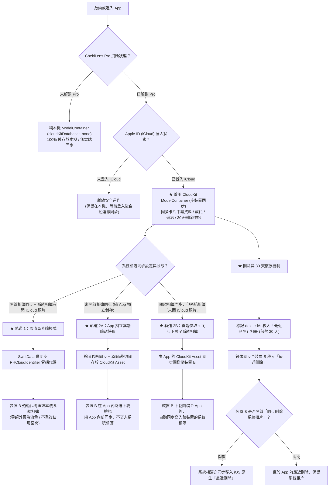

# ChekiLens 多裝置 iCloud 同步開發藍圖 (Phase 7: Multi-Device iCloud Sync Roadmap)

> **設計依據**：本文件依據 `/grill-me` 訪談結果與 iOS 18+ SwiftData / CloudKit / Photos Framework 原生架構定案。
> **生效條件**：使用者必須「登入 iCloud 帳號」且「解鎖 ChekiLens Pro 終身買斷版」。

---

## 🏗️ 核心架構與雙軌同步模型 (Architecture & Dual-Track Model)

---

## ⚙️ 關鍵技術細節與防護策略 (Critical Engineering Guards)

1. **商業化安全防護（Free vs Pro 隔離）**：
   - 避免 SwiftData 自動同步提早接管非付費使用者資料。
   - 未付費前採用 `cloudKitDatabase: .none`，僅在驗證 Pro + iCloud 登入後切換至 CloudKit 容器並執行自動資料注入。
2. **SwiftData Schema 規範適配（CloudKit Ready）**：
   - 所有實體（`ChekiItem`, `IdolGroup`, `IdolMember`, `ChekiMemo`）屬性全面補齊預設值或改為 Optional。
   - 新增 `cloudIdentifier`、`backCloudIdentifier` 與 `lastModifiedAt` 欄位。
3. **系統相簿識別碼跨裝置對應 (`PHCloudIdentifier`)**：
   - 透過 `PHPhotoLibrary.shared().cloudIdentifier(forLocalIdentifier:)` 將本機 ID 轉為通用雲端 ID。
   - 第二台裝置收到後透過 `localIdentifiers(for: [cloudIdentifier])` 解析出該裝置上的本機照片。
4. **刪除與復原策略（嚴格鏡像 ＋ 30 天「最近刪除」相簿）**：
   - **軟刪除標記 (Soft Delete)**：卡片遭刪除時記錄 `deletedAt = Date()`，移入 App 內建的「最近刪除 (Recently Deleted)」相冊，保留 30 天可隨時一鍵復原。
   - **遠端嚴格鏡像**：當裝置 A 刪除時，刪除狀態同步至裝置 B，裝置 B 亦將卡片移至「最近刪除」；若開啟「同步刪除系統相簿」，裝置相簿亦將照片移入 iOS 原生「最近刪除」（iOS 系統本身同樣提供 30 天復原期，雙向完美對齊）。
   - **復原 (Restore)**：點擊復原後，卡片立即恢復至原本歸屬的團體/成員與時間軸位置，並多裝置即時同步。
   - **永久清除 (Permanent Purge)**：超過 30 天之項目於背景自動硬刪除，使用者亦可手動「立即清空垃圾桶」。
5. **網路與效能排程**：
   - 全面自動適配 iOS 背景同步排程（低耗電模式自動暫停）。

---

## 📋 Phase 7 原子切片任務清單 (Atomic Task Breakdown)

### 階段 7.1：資料模型與 CloudKit 相容性重構 (Phase 7.1: Model CloudKit Compliance)
- [ ] **Task 7.1.1**: 重構 `ChekiItem`、`IdolGroup`、`IdolMember`、`ChekiMemo` 屬性宣告，全量補齊屬性預設值與相容性檢查，新增 `cloudIdentifier`、`backCloudIdentifier`、`lastModifiedAt` 欄位。
- [ ] **Task 7.1.2**: 實作 `PHCloudIdentifier` 轉換工具與相片跨裝置尋址模組 (`PhotoCloudIdentifierMapper.swift`)。

### 階段 7.2：雙模式 ModelContainer 與動態切換引擎 (Phase 7.2: Container Switching & CloudKit State)
- [ ] **Task 7.2.1**: 封裝 `CloudKitSyncManager.swift`，管理 iCloud 帳號狀態監測 (`CKContainer.accountStatus`)、同步狀態機（閒置/同步中/成功/錯誤）與最後同步時間戳記。
- [ ] **Task 7.2.2**: 升級 `ModelContainerProvider.swift`，支援根據 Pro 資格與使用者開關動態切換本機 Store (`.none`) 與 CloudKit Store (`.automatic`)，並實作既有本機 SQLite 資料自動遷移合併至 CloudKit 容器。

### 階段 7.3：雙軌圖片管理與隨選快取管線 (Phase 7.3: Dual-Track Image Pipeline & Cache)
- [ ] **Task 7.3.1**: 實作 `ChekiImageCacheManager.swift`（支援輕量縮圖生成、本機快取目錄存儲、LRU 空間管理與一鍵清除暫存快取）。
- [ ] **Task 7.3.2**: 實作 `ChekiCloudAssetService.swift`（負責 CloudKit Asset 背景隨選下載；若本機啟用「相簿同步」但系統相簿未啟用 iCloud 照片時，於圖檔下載後自動寫入該裝置系統相簿）。
- [ ] **Task 7.3.3**: 整合 `ChekiDetailView` 與相片加載元件，優先尋址本機系統相簿，Fallback 走 CloudKit 隨選快取，載入期間顯示平滑過渡動畫。

### 階段 7.4：嚴格鏡像刪除、30 天「最近刪除」相冊與復原機制 (Phase 7.4: Mirror Deletion & Trash Bin)
- [ ] **Task 7.4.1**: 在 `ChekiItem` 引入 `deletedAt: Date?` 軟刪除欄位，並實作一般圖庫自動過濾、已刪除拍立得 30 天自動過期硬刪除管線。
- [ ] **Task 7.4.2**: 實作 App 內「最近刪除」相冊 UI（比照 Apple 相簿工具相冊，支援剩餘天數倒數「還有 29 天」、批次復原、批次立即永久刪除）。
- [ ] **Task 7.4.3**: 實作雲端遠端刪除監聽器，當遠端刪除且本機開啟「同步刪除系統相簿」時，非同步刪除對應的 `PHAsset`；若遠端復原亦同步還原。
- [ ] **Task 7.4.4**: 撰寫多裝置並行修改、軟刪除同步與復原合併之單元測試（包含雙向編輯、離線更新與 LWW 合併）。

### 階段 7.5：UI 介面與設定控制面板 (Phase 7.5: Settings UI & Sync Dashboard)
- [ ] **Task 7.5.1**: 在 `SettingsView` 新增「iCloud 多裝置同步」獨立圓角卡片群組：
  - iCloud 帳號狀態指示燈（已連接 / 未登入 / 空間已滿）
  - Pro 權益狀態與解鎖引導
  - 同步總開關 Toggle
  - 同步狀態描述與最後同步時間（如「剛剛」、「10 分鐘前」）
  - 手動「立即同步」按鈕與旋轉進度指示
  - 本機暫存快取容量顯示與「清除暫存快取」按鈕
- [ ] **Task 7.5.2**: 多語系字串補齊（繁體中文與日文）與 iPad / 多裝置佈局適配。

### 階段 7.6：端到端整合驗證與實機多裝置驗收 (Phase 7.6: E2E Integration & Verification)
- [ ] **Task 7.6.1**: 單元測試與回歸測試驗證（模型架構、遷移邏輯、快取機制、CloudIdentifier 映射）。
- [ ] **Task 7.6.2**: 模擬器與多設備真實 CloudKit 測試環境聯調驗收。
